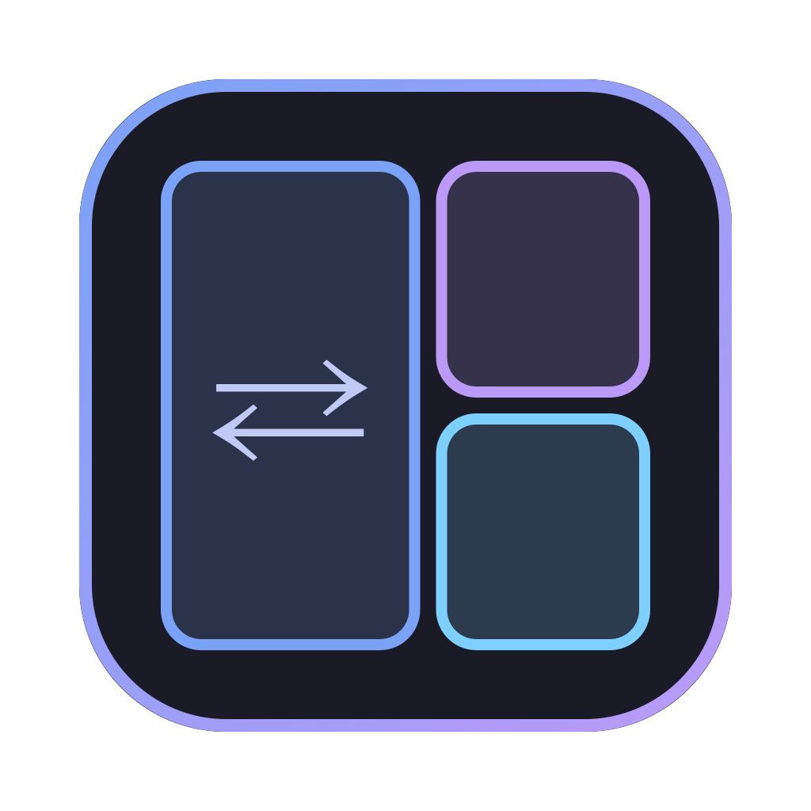

<p align="center">
  
</p>

<h1 align="center">WM Switcher</h1>

<p align="center">AeroSpace, Amethyst ve hyprmac arasında tek tıkla geçiş · macOS 14+</p>

<p align="center">
  <a href="https://github.com/bahayavas/wm-switcher/releases/latest/download/WMSwitcher-macOS.zip"></a>
  <a href="https://github.com/bahayavas/wm-switcher/releases/latest"></a>
</p>

## Kurulum

1. Yukarıdaki **İndir** düğmesiyle `WMSwitcher-macOS.zip` dosyasını indir (ya da sağdaki **Releases** bölümünden istediğin sürümü seç).
2. Zip'i aç ve **`Kur.command`** dosyasına çift tıkla. Bu betik:
   - `WM Switcher.app`'i **Uygulamalar** klasörüne kopyalar,
   - uygulamanın kullandığı `switch.sh` ve ayar dosyalarını `~/wm-switcher/` klasörüne koyar (var olan `.conf` dosyana dokunmaz),
   - uygulamayı açar.
3. macOS `Kur.command` için "geliştirici doğrulanamadı" derse: dosyaya **sağ tık → Aç** de.
   Uygulama Apple tarafından imzalanmadığı için aynısı ilk açılışta uygulama için de geçerli olabilir;
   gerekirse Terminal'de: `xattr -cr "/Applications/WM Switcher.app"`

Kaynaktan derlemek için aşağıdaki **Derleme** bölümüne bak.

---


AeroSpace, Amethyst ve hyprmac arasında tek tıkla geçiş. Aynı anda yalnızca biri çalışır.

## Kullanım

| Nereden | Ne |
|---|---|
| Dock ikonuna tıkla | Pencere: 3 kart (aktif olan gradyan çerçeveli), "Hepsini kapat", her WM için "Ayar dosyasını aç", "Login'de başlat" |
| Dock ikonuna sağ tıkla | Pencere açmadan geçiş; aktif olanın yanında ✓ |
| `⌃⌥⌘1` / `⌃⌥⌘2` / `⌃⌥⌘3` | AeroSpace / Amethyst / hyprmac |
| `⌃⌥⌘0` | Hepsini kapat (normal macOS) |
| Dock rozeti | Aktif WM'in harfi: A / M / H (hiçbiri yoksa rozet yok) |
| Terminal | `~/wm-switcher/switch.sh <aerospace\|amethyst\|hyprmac\|none\|restore\|status>` |

- Login'de yalnızca WM Switcher başlar ve son seçilen WM'i açar (`switch.sh restore`).
  WM'lerin kendi "launch at login" ayarlarını açma. Açarsan iki WM birden başlar.
- Bir WM switcher dışından açılırsa (Spotlight, hyprmac'in izin sonrası kendini yeniden
  başlatması…) yeni açılan kazanır: diğerleri kapatılır, seçim kaydedilir.
- Geçiş sırası: diğerlerine normal Quit → 3 sn bekle → `TERM` → 1 sn → `KILL`.
  Normal Quit önemli: AeroSpace ve hyprmac gizledikleri pencereleri kapanırken geri getirir.
  `KILL` ile ölürlerse ekran dışında pencere kalabilir.
- Seçim: `~/.config/wm-switcher/current`, geçiş günlüğü: `~/.config/wm-switcher/switch.log`

## Kısayollar

Ayarlar penceresi (⚙ Ayarlar, Dock menüsü → Ayarlar…, ya da `⌘,`): kutuya tıkla, yeni kısayola bas.
`⌫` siler, `⎋` vazgeçer, ↺ varsayılana döndürür. En az bir ⌃/⌥/⌘ gerekir. Değişiklik anında geçerli olur.

Kayıt dosyası `~/.config/wm-switcher/shortcuts.json`, AeroSpace biçiminde (`ctrl-alt-cmd-1`, `""` = yok).
Dosyada olmayan eylem varsayılanı alır: ⌃⌥⌘ + wms.conf sırası, "Hepsini kapat" ⌃⌥⌘0.

Çakışma uyarısı (`Conflicts.swift`): AeroSpace `[mode.main.binding]`, hyprmac `bind = …` ve Amethyst
(`default.amethyst` + `amethyst.yml`) okunur. Amethyst'in tercih penceresinde yapılan değişiklikleri göremez.
Varsayılan ⌃⌥⌘ + rakam üç WM'de de boş.

Test için: `WMSwitcher --snapshot <main|settings> çıktı.png` pencereyi açmadan görünümü çizer.

## Yeni bir WM eklemek

1. Uygulamayı kur.
2. `wms.conf`'a bir satır ekle:
   ```
   id|Görünen ad|bundle id|/Applications/X.app|~/ayar/dosyasi|Harf
   ```
   Bundle id'yi `osascript -e 'id of app "X"'` verir. Satır sırası varsayılan kısayol
   numarasıdır (4. satır → `⌃⌥⌘4`, en fazla 9). Ayarlar'dan değiştirilebilir.
3. WM Switcher'dan çık ve yeniden aç (Dock → sağ tık → Çık). Yeniden derlemek gerekmez.
   Pencerede 3'ten fazla kart olursa `ContentView.swift`'te `.frame(width: 520)` değerini büyüt.

## Derleme

```
./build.sh               # swift build → build/WM Switcher.app → /Applications
./build.sh --no-install
```

Ad-hoc imzalı. WM Switcher Accessibility izni istemez (kısayollar Carbon `RegisterEventHotKey`).
İlk geçişte macOS "WM Switcher, X'i denetlemek istiyor" diye sorabilir. Bu izin normal Quit
için gerekli. Reddedersen geçiş yine çalışır, ama WM'ler `TERM` ile kapanır.

## Dosyalar

```
switch.sh          geçiş mantığı (uygulama da bunu çağırır)
wms.conf           WM listesi
Sources/WMSwitcher main.swift (pencereler, Dock menüsü, uygulama menüsü), Switcher.swift
                   (durum, kısayol kaydı), ContentView.swift (ana pencere), SettingsView.swift,
                   Shortcut.swift (kısayol ↔ "ctrl-alt-cmd-1"), Conflicts.swift, HotKeys.swift
tools/make-icon.swift  ikon (build/AppIcon.icns silinirse yeniden çizilir)
```

AeroSpace ayarındaki tek değişiklik `start-at-login = false`. Yedek:
`~/.config/aerospace/aerospace.toml.bak-20261022-*`

## Lisans

[MIT](LICENSE) © 2026 Baha Yavaş
